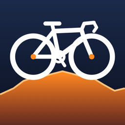
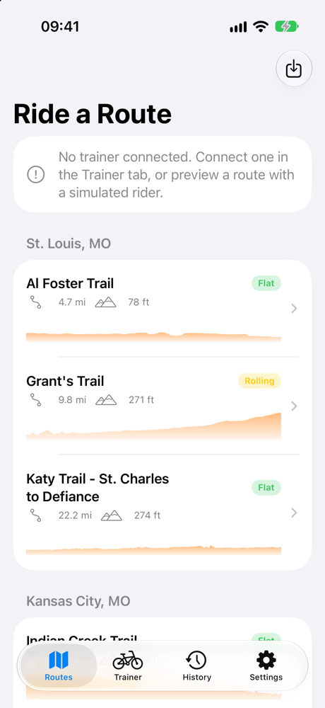
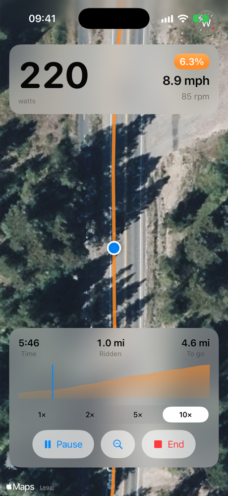

<p align="center">
  
</p>

<h1 align="center">Kinetic Revival</h1>

<p align="center">
  A standalone iPhone app that brings the <b>Kinetic T-6400</b> smart trainer back to life,
  with no account, cloud service or Kinetic software required.
</p>

<p align="center">
  
  &nbsp;&nbsp;
  
</p>

---

## Why this exists

Kinetic shut down, and its app went with it. The T-6400 trainer itself still works perfectly. It
turns out to speak the standard Bluetooth **FTMS** (Fitness Machine Service) protocol, so any app
that talks FTMS can control it. Kinetic Revival is that app: a native SwiftUI iPhone app that
connects straight to the trainer, sets resistance, and lets you ride real-world routes with the
trainer adjusting to the hills.

It should also work with any other FTMS indoor bike trainer, though it has only been tested on a
T-6400.

## Features

- **Direct Bluetooth control.** The app scans for FTMS trainers, connects, and shows live power,
  speed and cadence. It sets resistance manually or holds a target wattage (ERG mode).
- **Route rides, in the style of Rouvy or Zwift.** Ride a GPX route on a chase-cam satellite map.
  Your speed comes from real cycling physics (power, grade, weight, rolling resistance, aero drag),
  and the trainer gets harder on climbs and easier on descents.
- **29 built-in routes** across 11 cities, from flat river trails to the 2,285 ft Teton Pass
  climb (see [Built-in routes](#built-in-routes)). You can also import any GPX file of your own.
- **Previews.** Ride any route with a simulated 200 W rider, at 1×, 2×, 5× or 10× speed, before you
  get on the bike.
- **Apple TV / AirPlay.** The TV gets its own full-screen ride view (map, big numbers, elevation
  profile) instead of a mirror of the phone, and the phone stays the controller.
- **Spin-down calibration.** The app runs the trainer's FTMS spin-down, which measures roller and
  tyre drag.
- **Ride history and TCX export.** Rides are saved on the phone. Each one can be exported as TCX
  (including power) for Strava, TrainingPeaks or intervals.icu.
- **Safety first.** The app enforces its own limits on resistance, ERG wattage and grade. It
  releases the brake when you stop or disconnect, and restores your target if Bluetooth drops
  mid-ride.
- **Private by design.** The app has no accounts, no analytics and no server. Everything stays on
  your phone.

## Requirements

| | |
|---|---|
| **Phone** | iPhone running iOS 17 or later |
| **Mac** | Xcode 16 or later (Swift 6), plus [XcodeGen](https://github.com/yonaskolb/XcodeGen) |
| **Apple ID** | A free Apple ID is enough to install the app on your own phone |
| **Trainer** | Kinetic T-6400, or any Bluetooth FTMS trainer |

The app isn't on the App Store. You build it and install it on your phone from Xcode.

## Install on your iPhone

1. **Install XcodeGen** (once):
   ```sh
   brew install xcodegen
   ```
2. **Clone and generate the Xcode project.** `project.yml` is the source of truth, and the
   `.xcodeproj` is generated from it (and git-ignored):
   ```sh
   git clone https://github.com/lane-maxwell/kurt_trainer.git
   cd kurt_trainer
   xcodegen generate
   ```
3. **Set your signing team.** Create `Local.xcconfig` next to `project.yml`:
   ```
   LOCAL_DEVELOPMENT_TEAM = ABCDE12345
   ```
   You can find your team ID in Xcode → Settings → Accounts (a free Apple ID gives you a "Personal
   Team"). Put it in this file rather than Xcode's Signing & Capabilities tab, because
   `xcodegen generate` rewrites the project but never touches this file. The file is git-ignored.
4. **Run it.** `open KineticRevival.xcodeproj`, pick your iPhone as the run destination, and press
   ⌘R. The first time, trust the developer profile on the phone under Settings → General → VPN &
   Device Management.

With a free Apple ID, the app expires after 7 days. To renew it, run it from Xcode again.

> Bluetooth doesn't work in the iOS Simulator. The simulator is fine for previewing routes with the
> simulated rider, but you need a real phone to ride.

## Using the app

### Connect the trainer

Open the **Trainer** tab and tap your trainer. Only one app can control the trainer at a time, so
close any other trainer apps first. Once connected, you can set resistance manually or switch to
ERG and pick a wattage.

### Ride a route

1. In the **Routes** tab, pick a route. Routes are grouped by city and show their distance, total
   climb, a terrain badge (Flat / Rolling / Hilly / Mountain) and an elevation profile. The list is
   searchable.
2. On the route page, tap **Start ride** to ride with the trainer, or **Preview with a simulated
   200 W rider** to watch the route first.
3. During the ride you see power, speed, cadence, the current grade, time, distance ridden and
   distance to go, plus an elevation profile with your position. The magnifier button switches
   between **Close** and **Wide** camera views.
4. When you finish or tap End, you get a summary, and the ride is saved to **History**.

**Importing your own routes:** tap the import button at the top of the Routes tab and pick a GPX
file, or copy GPX files into the app's `Routes` folder with Finder (the app supports file sharing).
Imported routes appear under **My Routes**.

**Settings:** set your rider and bike weight (used for the physics), metric or imperial units, and
the **trainer difficulty** (default 50%). Difficulty scales how much of each hill's grade the trainer actually applies. At
50%, a 10% climb feels like 5% on the trainer, while your speed on the route still uses the full
grade.

### Ride on the TV

Start the ride on the phone, then open Control Center → Screen Mirroring → pick your Apple TV. The
TV switches to a dedicated full-screen view, and the phone keeps its controls.

### Calibrate

Trainer tab → ⋯ → **Calibrate (spin-down)**. Pedal up to the target speed the app shows, then stop
pedaling when it tells you to. The trainer measures how long it takes to coast down. On a
wheel-on trainer like the T-6400, recalibrate after you change the roller tension, the tyre
pressure, or when the tyre has warmed up.

### Export a ride

In **History**, open a ride and share it as TCX. Strava treats a TCX with GPS as an outdoor ride,
so change the activity type to *Virtual Ride* after uploading.

## Built-in routes

All of these were built from open data (see [Route data and licensing](#route-data-and-licensing)).
The city collections are ordered starting from St. Louis.

| City | Route | Distance | Climb |
|---|---|---|---|
| St. Louis, MO | Al Foster Trail | 4.7 mi (7.5 km) | 78 ft |
| | Grant's Trail | 9.8 mi (15.8 km) | 271 ft |
| | Katy Trail – St. Charles to Defiance | 22.2 mi (35.8 km) | 281 ft |
| Kansas City, MO | Indian Creek Trail | 15.7 mi (25.3 km) | 248 ft |
| | Trolley Track Trail | 4.6 mi (7.4 km) | 208 ft |
| Chicago, IL | Lakefront Trail | 17.8 mi (28.7 km) | 264 ft |
| | North Shore Channel Trail | 7.2 mi (11.6 km) | 78 ft |
| | The 606 (Bloomingdale Trail) | 2.8 mi (4.4 km) | 10 ft |
| Savannah, GA | Forsyth Park to Isle of Hope | 8.6 mi (13.8 km) | 75 ft |
| Charleston, SC | Charleston Peninsula Loop | 5.7 mi (9.2 km) | 38 ft |
| Austin, TX | Lady Bird Lake (Butler Trail) | 6.2 mi (10.1 km) | 129 ft |
| | Southern Walnut Creek Trail | 7.7 mi (12.4 km) | 114 ft |
| Denver, CO | Cherry Creek Trail | 6.7 mi (10.8 km) | 220 ft |
| | Clear Creek Trail | 11.1 mi (17.8 km) | 548 ft |
| | Lookout Mountain Climb | 6.1 mi (9.9 km) | 1,509 ft |
| | South Platte River Trail | 9.0 mi (14.6 km) | 176 ft |
| New York, NY | Hudson River Greenway | 13.8 mi (22.2 km) | 289 ft |
| | Manhattan – City Hall to Central Park | 10.7 mi (17.2 km) | 316 ft |
| Boston, MA | Charles River Path – Boston to Waltham | 12.4 mi (20.0 km) | 117 ft |
| | Minuteman Bikeway | 8.1 mi (13.1 km) | 125 ft |
| | Neponset River Greenway | 5.3 mi (8.5 km) | 81 ft |
| | Northern Strand Trail | 8.4 mi (13.5 km) | 67 ft |
| Jackson Hole, WY | Teton Park Road – Moose to Jenny Lake | 7.4 mi (11.9 km) | 351 ft |
| | Teton Pass from Wilson | 5.6 mi (9.1 km) | 2,285 ft |
| San Diego, CA | Bayshore Bikeway – Silver Strand | 8.2 mi (13.1 km) | 49 ft |
| | Mission Bay Loop | 11.9 mi (19.1 km) | 158 ft |
| More Cities | Burke-Gilman Trail (Seattle) | 15.6 mi (25.2 km) | 282 ft |
| | Capital Crescent Trail (DC) | 7.0 mi (11.3 km) | 321 ft |
| | Midtown Greenway (Minneapolis) | 4.2 mi (6.7 km) | 56 ft |

There is also a synthetic **Demo Climb** under *Getting Started*.

## How it works

### Architecture

```
KineticRevival/
├── App/          AppModel (shared state), app entry, AppDelegate + external-display scene
├── Bluetooth/    BluetoothManager: CoreBluetooth scanning, connection, auto-reconnect
├── FTMS/         Pure byte encoding/decoding of the FTMS characteristics
├── Trainer/      ControlPointClient, TrainerController, SafetyLimits, RideMetrics
├── Routes/       Route model, GPX parser, geo math, terrain classification, route library
├── Ride/         BikePhysics, GradeSync, RideSession, ride history, TCX export
├── Views/        SwiftUI screens (routes, ride, trainer, history, settings, calibration)
│   └── TV/       Full-screen AirPlay / external display views
└── Resources/
    └── Routes/   Built-in GPX files, one folder per city, ordered by order.json
KineticRevivalTests/   Swift Testing suites (FTMS parsing, control point, physics, routes, …)
tools/                 Python route builders and the app icon generator
```

- **`FTMS/`** has no Bluetooth code. It only converts bytes to values and back, which makes it
  easy to test against captured packets.
- **`ControlPointClient`** serializes control-point commands. It sends one command at a time,
  waits for the trainer's response, and times out after 5 s.
- **`TrainerController`** owns the trainer's state: requesting control, resistance, ERG and
  simulation targets, the spin-down state machine, and restoring the target after a dropout.
- **`RideSession`** advances the ride every 100 ms. It reads power from the trainer (or the
  simulated rider), runs the physics, moves you along the route, and sends the grade to the trainer.
- The ride map sets the camera **every display frame** instead of chaining MapKit animations. This
  keeps the rider marker exactly on the route.

### Speed and grade

Speed is **not** read from the flywheel. `Ride/BikePhysics.swift` integrates rider power against
gravity on the current grade, rolling resistance and aerodynamic drag, using your rider and bike
weight. It uses small time steps, so steep climbs and starts from a standstill behave sensibly.

The grade goes to the trainer through FTMS **Indoor Bike Simulation** (op code `0x11`), scaled by
the difficulty setting. `GradeSync` rate-limits these updates so the brake isn't hammered with
tiny changes. If the trainer refuses `0x11`, the app falls back to mapping the grade onto a
resistance level (`resistance = 10 + 3 × grade%`, clamped to 0–100). These constants are a
starting point and should be tuned to feel.

### Safety limits

The T-6400 reports implausible supported ranges (resistance ±200, power ±4000 W), so the app
ignores them and enforces its own limits in `Trainer/SafetyLimits.swift`:

| Setting | Range |
|---|---|
| Resistance | 0–100 |
| ERG target | 50–400 W |
| Simulated grade | −15% to +20% |

The trainer drops its brake to zero whenever the Bluetooth link goes. After an *unexpected*
dropout, the app re-sends the last target if the link comes back within 60 s. If you disconnect on
purpose, the app releases the brake to zero and restores nothing.

## T-6400 protocol notes

The T-6400 advertises the standard FTMS service (`0x1826`). Control point (`0x2AD9`) and machine
status (`0x2ADA`) traffic observed on real hardware:

| Command | Bytes sent | Response |
|---|---|---|
| Request control | `00` | `80 00 01` (success) |
| Set target resistance 10.0 | `04 64 00` | `80 04 01`, then status `07 64 00`; the brake engages |
| Spin-down calibration | `13 01` | Works as specified |

Resistance is a **signed 16-bit value in tenths** (`0x0064` = 10.0). The FTMS 1.0 specification
says uint8, so other apps that follow the spec literally may misbehave with this trainer.

### Verification status

| Feature | Status |
|---|---|
| Connect, request control, telemetry | ✅ Verified on a T-6400 |
| Manual resistance | ✅ Verified |
| Brake release on disconnect, restore after dropout | ✅ Verified |
| Spin-down calibration (`0x13`) | ✅ Verified |
| ERG mode (`0x05`) | ⚠️ Implemented, not yet verified on hardware |
| Indoor Bike Simulation (`0x11`) | ⚠️ Implemented with automatic resistance fallback, not yet verified |
| AirPlay / external display scene | ⚠️ Implemented, not yet tested on a real Apple TV |

Reports from other T-6400 owners, or from other FTMS trainers, are very welcome.

## Building routes

The built-in routes are generated by the scripts in `tools/` (Python 3.10+, standard library only).
Each script reads a JSON spec list and writes GPX files into
`KineticRevival/Resources/Routes/<City>/`.

### Follow a named trail: `osm_trail_to_gpx.py`

Specs are in `tools/routes.json`:

```json
{
  "collection": "Boston, MA",
  "name": "Minuteman Bikeway",
  "osm": "Minuteman Bikeway",
  "bbox": "42.38,-71.30,42.48,-71.13"
}
```

```sh
python3 tools/osm_trail_to_gpx.py https://overpass-api.de/api/interpreter \
  tools/routes.json KineticRevival/Resources/Routes
```

The script:

1. Downloads every OpenStreetMap way with that trail name (one name or a list) inside the
   bounding box from the Overpass API.
2. Builds a graph and takes the line between the trail's two farthest-apart dead ends. Without
   this, a trail mapped as two parallel paths would ride up one and back down the other.
3. Fills gaps larger than 40 m with the FOSSGIS bike router (`max_gap` defaults to 600 m).
   Optional `gap_vias` keep the router on the right path.
4. Levels tagged bridges and tunnels. Elevation models see the river or road underneath, which
   turns a bridge into a fake wall.
5. Samples elevation from USGS 3DEP 10 m data via [OpenTopoData](https://www.opentopodata.org/),
   with a median filter to remove spikes.

The public Overpass servers are often overloaded. The script retries, and you can pass a different
endpoint (for example `https://overpass.private.coffee/api/interpreter`).

### Route through waypoints: `route_designer.py`

For street rides, loops and road climbs. Specs are in `tools/designed_routes.json`:

```sh
python3 tools/route_designer.py tools/designed_routes.json KineticRevival/Resources/Routes ["Route name" ...]
```

| Option | Meaning |
|---|---|
| `waypoints` | `[[lat, lon], ...]`, routed in order by the FOSSGIS router |
| `loop` | Return to the start |
| `direction: "uphill"` | Reverse the route if needed so it climbs |
| `profile: "road"` | Use the car profile. The bike profile likes to detour onto mountain trails. |
| `smoothing` | Moving-average window in 15 m points (default 7) |
| `max_grade` | Clip DEM artifacts on paved roads (e.g. `0.12`) |

### Check a new route before shipping it

- **Check how far the route is from the trail it claims to follow, not just the street names.** A
  road running alongside a trail passes a street-name check while sitting 300 m away.
- **Check that the route doesn't retrace itself**, except where a loop starts and ends.
- **Run the test suite.** `BundledRouteRideTests` rides every bundled route to the finish at 250 W
  and fails on stalls or position jumps. `gentleBundledTrailsHaveNoWalls` catches elevation
  artifacts on trails that should be gentle.

### Personal GPX files

`tools/import_gpx.py <in.gpx> <out.gpx> "<name>" [--reelevate]` cleans up a third-party GPX
(renames it and optionally replaces its elevation with USGS data). Import the result through the
app's import button. **Don't add it to `Resources/Routes`**: files from sites like RideWithGPS or
AllTrails carry their own terms and can't be redistributed. A test (`bundledRoutesComeFromOpenData`)
fails if one is bundled.

## License

The app source code and tools are released under the [MIT License](LICENSE). The bundled route
files are derived from OpenStreetMap data and are covered by the ODbL instead (see below).

## Route data and licensing

- **Route geometry** © [OpenStreetMap](https://www.openstreetmap.org/copyright) contributors,
  available under the Open Database License (ODbL). The bundled GPX files are derived from OSM data
  and remain under the ODbL.
- **Routing** for gap filling and designed routes is by the [FOSSGIS](https://routing.openstreetmap.de/)
  OSRM servers.
- **Elevation** is from the USGS 3D Elevation Program (public domain), served by OpenTopoData.
- **Maps** during rides are Apple Maps (MapKit).

These credits also appear in the app's Settings tab.

## Development

```sh
xcodegen generate     # after adding, removing or renaming files
xcrun simctl boot "iPhone 17"
xcodebuild test -project KineticRevival.xcodeproj -scheme KineticRevival \
  -destination 'platform=iOS Simulator,name=iPhone 17'
```

Boot the simulator before running `xcodebuild test`, or it can sit waiting for the device. The
suite (146 tests, using Swift Testing) covers FTMS parsing and encoding, the control-point client,
trainer state and safety limits, physics, GPX parsing, persistence and TCX export, plus full ride
simulations over every bundled route.

Project conventions:

- Swift 6 with strict concurrency checking.
- Structured logging with `os.Logger`. Errors are surfaced, never silently swallowed.
- Conventional commit messages (`feat(ride): …`, `fix(routes): …`).
- `tools/make_app_icon.swift` draws the app icon. Edit it and re-run it to change the artwork:
  `swift tools/make_app_icon.swift <output.png>`.

## Roadmap

- **Real-ride video:** play GoPro footage of a route synced to your speed, for true street-level
  immersion.
- **Structured workouts:** intervals in ERG mode.
- **Strava upload** directly from History.
- **Per-route surface:** a rolling-resistance setting for gravel and trails.
- **Hardware verification** of ERG, simulation mode and the AirPlay scene (see above).

## Acknowledgements

Thanks to the OpenStreetMap community, whose trail mapping makes the built-in routes possible, and
to everyone who kept their Kinetic trainer out of a landfill.
